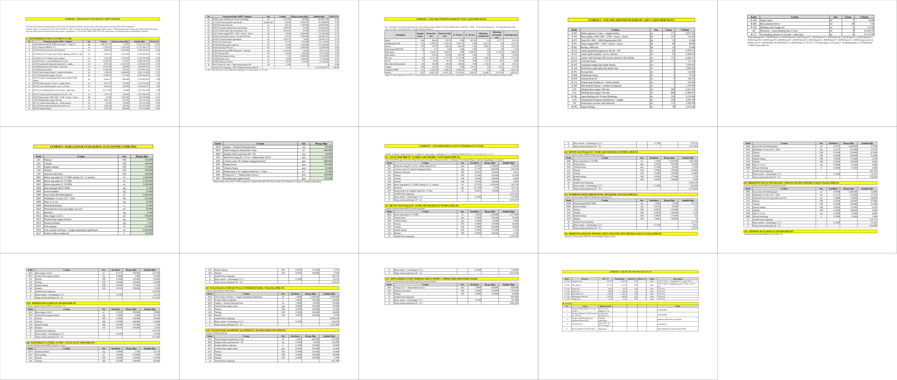
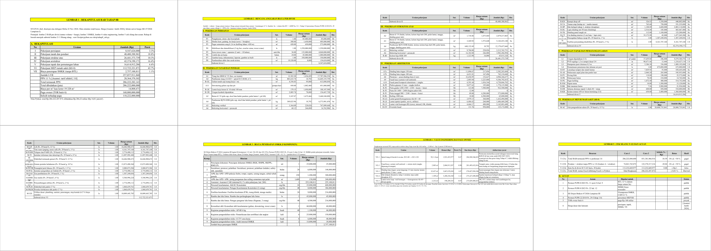
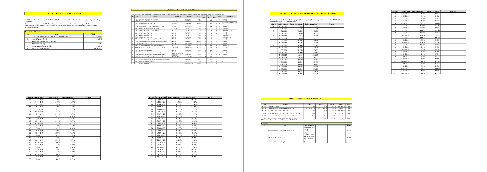

# Laporan Audit Akhir Studi Kasus RS Tepian Batanghari

Status: **disetujui Defsa 23 Nov 2026** (diaudit dan diperbaiki atas delegasi; temuan, keputusan K-AU1..K-AU4, dan Bab VIII.2 ditelaah Defsa). DATA SIMULASI untuk studi kasus portofolio, tidak untuk konstruksi. Versi Word/PDF: `10 Laporan/Audit Akhir.docx` dan `.pdf`, dibangun dari berkas ini oleh `skrip/audit_akhir.py`.

## Ringkasan Eksekutif

Audit akhir memeriksa seluruh keluaran Tahap 0-10 sebelum portofolio diterbitkan: konsistensi angka antar tahap, tanggal simulasi, kelengkapan cek silang, sumber angka, kerapian skrip, dan format Word/Excel. Pemeriksaan memakai `grep` pada semua berkas Markdown, pindai teks 88 berkas Word/Excel yang di-commit, dan render PDF tiga buku kerja Excel Tahap 8 dan 9.

Hasil pokok sebagai berikut.

- Ditemukan **16 butir**: 1 tingkat tinggi, 3 sedang, 7 rendah, dan 5 butir pemeriksaan yang sesuai tanpa temuan.
- **Temuan tinggi (AU-02):** RKS 7.7 masih menulis 319 tiang (251 gedung utama), padahal desain akhir sesudah 7.3 adalah **321 tiang (253 gedung utama), 84 pile cap**. RKS sudah diperbaiki dan dibangun ulang; jumlah uji PIT tambahan ikut disesuaikan menjadi 25 / 11 (keputusan K-AU1).
- Laporan Akhir Bab IX masih mencantumkan O-1 (render) yang sudah ditutup; tabel butir terbuka diperbarui dan Laporan Akhir dibangun ulang.
- Angka kunci lain konsisten di semua dokumen: luas 19.328 m², RAB Rp 286,22 miliar (Rp 14,81 juta/m²), rekayasa nilai Rp 11,19 miliar, jadwal 98 minggu mulai 3 Januari 2028.
- Butir terbuka Tahap 7 O-2 ditutup; O-4 dan O-8 ditandai di luar lingkup portofolio karena tidak mengubah angka RAB, jadwal, atau laporan. O9-3 (cek format Excel) ditutup.
- Format Excel Tahap 8/9 lolos; tiga catatan tampilan kecil, dua di antaranya sudah dirapikan (durasi bulat, lembar lebar dicetak A3).
- Status Tahap 7-10 diseragamkan, lalu **disetujui Defsa 23 Nov 2026** setelah telaah.

## I. Pendahuluan

### 1.1 Latar Belakang dan Tujuan

Tahap 7-10 dikerjakan dalam Mode cepat: AI menghitung dan memutuskan atas delegasi Defsa, dan Defsa menelaah satu ringkasan per tahap. Karena banyak angka berubah di tengah jalan (jumlah tiang, tanggal mulai konstruksi, status render), perlu satu pemeriksaan menyeluruh agar laporan, RKS, RAB, jadwal, dan halaman portofolio memakai angka yang sama. Audit ini adalah sesi 2 dari 4 penyelesaian 100 % (`SERAH TERIMA.md` bagian 3).

### 1.2 Lingkup

**Tabel: Lingkup Audit**

| Kode | Butir | Uraian |
|---|---|---|
| B1 | Konsistensi angka | Jumlah tiang dan cap, luas, RAB, VE, durasi di semua md, docx, xlsx |
| B2 | Tanggal simulasi | Laporan Antara April 2027, Laporan Akhir Agustus 2027, konstruksi 3 Jan 2028 |
| B3 | Cek silang | Semua T-xx di `VERIFIKASI.md` punya hasil; yang gagal punya penjelasan |
| B4 | Sumber angka | SNI/pasal atau label [Asumsi]/[Literatur]; `acuan/privat` tidak ter-commit |
| B5 | Skrip | Skrip tidak dirujuk, skrip tanpa uji |
| B6 | Format | Word/Excel sesuai `FORMAT LAPORAN DAN EXCEL.md` |
| A4 | Excel ke PDF | Buku kerja Tahap 8 dan 9 dirender untuk cek format (O9-3) |
| A5 | Butir terbuka | O-2, O-4, O-8: tutup atau tandai di luar lingkup |
| A7 | Label status | Tetap "menunggu telaah Defsa" sampai Defsa menyetujui |

Sumber: `SERAH TERIMA.md` bagian 2A dan 2B.

### 1.3 Metode

1. Pencarian teks (`grep -n`) atas semua berkas `.md` untuk angka kunci dan angka lama (319, 83 cap, 4 Jan 2027, 373 tiang).
2. Pindai teks isi `word/document.xml` dan `xl/sharedStrings.xml` pada 88 berkas `.docx`/`.xlsx` yang di-commit dengan pola yang sama.
3. Baca baris `VERIFIKASI.md` yang hasilnya bukan "Lolos", lalu cek kolom catatan.
4. Cek `.gitignore` dan riwayat git untuk `acuan/privat`, `acuan/pustaka`, `acuan/jurnal`.
5. Cari skrip `skrip/*.py` yang tidak dirujuk skrip, uji, md, atau peluncur mana pun.
6. Render buku kerja 8a, 8b, dan 9 ke PDF lewat Microsoft Excel, lalu periksa orientasi, *fit to page*, baris judul berulang, *freeze panes*, dan tampilan halaman.
7. Perbaikan kecil langsung dikerjakan; perbaikan yang mengubah angka dicatat sebagai keputusan atas delegasi Defsa (Bab VII).

Tanpa OpenSees, Blender, atau seluruh `pytest` (laptop panas, O-10); hanya uji berkas yang disentuh.

### 1.4 Tingkat Temuan

**Tabel: Kriteria Tingkat Temuan**

| Tingkat | Arti | Tindakan |
|---|---|---|
| T (tinggi) | Angka salah di dokumen kontrak atau laporan yang diserahkan | Wajib diperbaiki sebelum terbit |
| S (sedang) | Dokumen tidak konsisten, tetapi angka di dokumen akhir benar | Diperbaiki atau diberi catatan pembaruan |
| R (rendah) | Format, kerapian, atau butir di luar lingkup portofolio | Ditandai, diperbaiki bila murah |
| - (sesuai) | Pemeriksaan tanpa temuan | Dicatat sebagai bukti audit |

## II. Ringkasan Hasil

### 2.1 Rekap Temuan

**Tabel: Rekap Temuan per Tingkat**

| Tingkat | Jumlah | Diperbaiki | Ditutup / ditandai | Nomor |
|---|---|---|---|---|
| T | 1 | 1 | 0 | AU-02 |
| S | 3 | 3 | 0 | AU-01, AU-03, AU-04 |
| R | 7 | 2 | 5 | AU-05..AU-10, AU-15 |
| Sesuai | 5 | - | - | AU-11..AU-14, AU-16 |
| **Jumlah** | **16** | **6** | **5** | |

### 2.2 Berkas yang Diubah

**Tabel: Berkas yang Diubah oleh Audit**

| Berkas | Perubahan | Temuan |
|---|---|---|
| `skrip/tahap7_rks.py` | `tiang_n` 321, `tiang_utama` 253 (sumber 7.5), PIT 25 / 11, teks PIT memakai konstanta | AU-02, AU-03 |
| `07 DED dan RKS/7.7 RKS.docx` dan `.pdf` | Dibangun ulang dari skrip | AU-02 |
| `skrip/laporan_akhir.py` | Tabel Butir Terbuka: O-1 dihapus, O-2 / O-4 / O-8 ditambah | AU-04 |
| `10 Laporan/Laporan Akhir.docx` dan `.pdf` | Dibangun ulang dari skrip | AU-04 |
| `07 DED dan RKS/Ringkasan Tahap 7.md` | Status; O-2 ditutup; O-4, O-8 di luar lingkup | AU-05..AU-08 |
| `06 Struktur Bawah dan Basement/6.10 Gambar Pondasi.md`, `Ringkasan Tahap 6.md` | Catatan angka akhir 321 / 253 / 84 | AU-01 |
| `09 Jadwal/Ringkasan Tahap 9.md` | O9-3 ditutup | AU-09 |
| `10 Laporan/00 Rencana Tahap 10.md` | Status "menunggu telaah Defsa" | AU-08 |
| `VERIFIKASI.md` | T-27 ditandai | AU-10 |
| `10 Laporan/Audit Akhir.md`, `.docx`, `.pdf`, `skrip/audit_akhir.py`, `10 Laporan/Lampiran Audit/` | Baru | - |

## III. Temuan dan Perbaikan

### 3.1 Daftar Temuan

**Tabel: Daftar Temuan Audit**

| No | Butir | Temuan | Tingkat | Perbaikan | Status |
|---|---|---|---|---|---|
| AU-01 | B1 | `6.10 Gambar Pondasi.md` dan Ringkasan Tahap 6 masih 319 tiang / 83 cap; gambar GS-28/29/32 sudah dibangun ulang 7.5 dengan 321 / 84 | S | Catatan "diperbarui 7.5: 321 tiang (253 utama + 68 utilitas), 84 cap" di 6.10 dan angka akhir di Ringkasan Tahap 6 | Diperbaiki |
| AU-02 | B1 | **RKS 7.7 menulis 319 tiang (251 utama)** di Subbab 1.1 dan Tabel 4.1; desain akhir sesudah 7.3 adalah 321 (253) | T | `tahap7_rks.py`: `tiang_n` 321, `tiang_utama` 253 (sumber `7.5 Gambar Struktur.md`); RKS dibangun ulang | Diperbaiki |
| AU-03 | B1 | Jumlah uji PIT tambahan di RKS (24 / 11) dihitung 6.8 dari 319 / 251 | S | Keputusan K-AU1: **25 / 11** | Diperbaiki (angka berubah) |
| AU-04 | B1 | Laporan Akhir Bab IX masih memuat O-1 (ditutup 23 Nov 2026, PR #79); O-2/O-4/O-8 tidak tercantum | S | Baris O-1 dihapus; baris O-2 / O-4 / O-8 ditambah; Laporan Akhir dibangun ulang | Diperbaiki |
| AU-05 | A5 | O-2: IFC STR 6.9 tanpa Cap E diperlebar + 2 tiang | R | Ditutup: IFC STR 7.3 (321 IfcPile, 84 IfcFooting) adalah model akhir dan sumber Qto 8a (T-119a lolos); 6.9 tetap rekaman Tahap 6 | Ditutup |
| AU-06 | A5 | O-4: ARS 7.1 / GA-11 atap belum menampilkan letak chiller 7.3 | R | Di luar lingkup portofolio: letak alat ada di federasi 7.2 dan GM-03 | Ditandai |
| AU-07 | A5 | O-8: validasi IFC 16/20 (Pset tambahan) | R | Di luar lingkup portofolio: Qto memakai BaseQuantities (T-119a/b lolos) | Ditandai |
| AU-08 | A7 | Ringkasan Tahap 7 masih "7.8 render belum selesai"; Rencana Tahap 10 tanpa "menunggu telaah Defsa" | R | Status Tahap 7 dan 10 diseragamkan dengan Tahap 8 dan 9 | Diperbaiki |
| AU-09 | A4/B6 | Excel 8a, 8b, 9: tiga catatan format kecil (lihat Bab VI) | R | Durasi minggu tampil bulat; lembar Kegiatan dan Value Engineering dicetak A3; lembar AHSP dibiarkan. Excel dibangun ulang, angka sama | Diperbaiki |
| AU-10 | B3 | T-27 (PGA, cek silang peta PuSGeN) berstatus "Belum" sejak Tahap 2 | R | Tidak dilakukan, di luar lingkup: PGA 0,164 g dari aplikasi resmi PUPR 2021 adalah sumber primer | Ditandai |
| AU-11 | B3 | Cek silang yang gagal: T-102, T-106, T-113, T-121a, T-121b, T-125 | - | Semua punya penjelasan dan keputusan (Bab V) | Sesuai |
| AU-12 | B1 | Luas, RAB, VE, durasi konsisten di md dan docx (Bab IV) | - | - | Sesuai |
| AU-13 | B2 | Tanggal simulasi berurutan; "4 Jan 2027" hanya tersisa sebagai catatan riwayat K10-8 | - | - | Sesuai |
| AU-14 | B4 | `acuan/privat`, `pustaka`, `jurnal` di `.gitignore` dan tidak pernah ada di riwayat git | - | - | Sesuai |
| AU-15 | B5 | Dua skrip tidak dirujuk (`rapat_laporan_pendahuluan.py`, `tahap0_rapikan_matriks.py`); lima skrip peluncur tanpa uji | R | Dibiarkan: pembangkit dokumen sekali jalan, berguna untuk membangun ulang | Ditandai |
| AU-16 | B6 | Laporan Akhir dan RKS dibangun ulang lewat `format_dokumen` + Word | - | Format Laporan Akhir sudah dicek di PR #79 | Sesuai |

Sumber: pemeriksaan audit 23 Nov 2026.

### 3.2 Uraian Temuan Utama

**AU-02 (tinggi).** RKS adalah dokumen kontrak yang dibaca kontraktor. Skrip `tahap7_rks.py` mengambil jumlah tiang dari Ringkasan Tahap 6 (319 / 251), sedangkan langkah 7.3 menambah 2 tiang Ø800 pada perlebaran Cap E untuk pit lift L-7 sehingga desain akhir menjadi 321 tiang (253 gedung utama + 68 utilitas) dan 84 pile cap. Model STR 7.3, gambar GS-28/29/32 (7.5), RAB 8a, jadwal 9, dan Laporan Akhir sudah memakai 321; hanya RKS yang tertinggal. Sumber angka di skrip dipindah ke `7.5 Gambar Struktur.md`, dan uji `test_tahap7_rks.py` (T-116) memastikan angka itu ada di berkas sumbernya.

**AU-03 (sedang).** Program uji tiang 6.8 memakai aturan PIT 1 per 5 tiang. Dengan 321 tiang dibutuhkan 65 uji PIT (sebelumnya 64), sedangkan gedung utama tetap 51 (253 / 5 = 50,6). Karena 40 uji sudah direncanakan, tambahan menjadi 25 / 11. Selisih satu uji PIT tidak berarti bagi RAB dan jadwal, sehingga keduanya tidak dihitung ulang.

**AU-04 (sedang).** Laporan Akhir adalah dokumen yang paling banyak dibaca. Tabel Butir Terbuka harus mencerminkan keadaan terakhir: render (O-1) sudah selesai, dan O-2 / O-4 / O-8 perlu tercantum supaya pembaca tahu ketiganya sengaja tidak dikerjakan.

**AU-01 (sedang).** Dokumen Tahap 6 adalah rekaman tahap. Angkanya tidak diubah, tetapi diberi catatan pembaruan agar pembaca tidak memakai 319 / 83 sebagai angka akhir.

## IV. Konsistensi Angka Kunci

**Tabel: Angka Kunci dan Dokumen yang Dicek**

| Besaran | Nilai akhir | Sumber | Dicek di | Hasil |
|---|---|---|---|---|
| Jumlah tiang bor Ø800 | 321 (253 utama + 68 utilitas) | 7.3, 7.5 | Ringkasan 7/8/9, 9 Jadwal, Laporan Akhir, Halaman Portofolio, RKS | Sesuai setelah AU-02 |
| Jumlah pile cap | 84 | model STR 7.3 | Ringkasan 7/8, Laporan Akhir | Sesuai |
| Luas kotor | 19.328 m² (14.976 + 4.352) | Ringkasan Tahap 3 | 8b, Laporan Antara, Laporan Akhir, Halaman Portofolio | Sesuai |
| RAB termasuk PPN | Rp 286,22 miliar | Ringkasan Tahap 8 | 8b xlsx, Laporan Akhir, Halaman Portofolio, PROGRES | Sesuai |
| RAB sebelum PPN | Rp 257,86 miliar | 8b | Jadwal 9 (bobot), Laporan Akhir (T-126) | Sesuai |
| Biaya per m² | Rp 14,81 juta/m² | 8b | Laporan Akhir, Halaman Portofolio | Sesuai |
| Rekayasa nilai | VE-1..VE-5 Rp 11,19 miliar; usul VE-6 ±Rp 2,10 miliar | 8b, T-125 | Laporan Akhir; Halaman Portofolio "±Rp 13 miliar" = gabungan | Sesuai |
| Durasi | 98 minggu (22,6 bulan) | Ringkasan Tahap 9 | Laporan Akhir (T-127), Halaman Portofolio | Sesuai |
| Mulai dan selesai konstruksi | 3 Jan 2028 - 19 Nov 2029 | K10-8 | 9 xlsx, Laporan Akhir | Sesuai |
| Laporan Antara / Akhir | April 2027 / Agustus 2027 | Tahap 3, 10 | Laporan Antara, Laporan Akhir, notulen | Sesuai |

Sumber: pindai teks md, docx, dan xlsx 23 Nov 2026.

Angka 373 tiang hanya muncul di dokumen Tahap 3 dan 5.1 (desain konsep sebelum optimasi Tahap 6) dan di penjelasan T-121b; itu rekaman tahap, bukan angka akhir. Tanggal Mei-Juli 2027 pada data Tahap 4 dan 6 berada di antara Laporan Antara dan Laporan Akhir, jadi urutan waktu simulasi utuh.

## V. Cek Silang dan Sumber Angka

### 5.1 Cek Silang yang Gagal atau Belum

**Tabel: Cek Silang di Luar Toleransi**

| Kode | Besaran | Selisih | Penjelasan dan keputusan |
|---|---|---|---|
| T-18 | σ'p lempung lunak U4 | sebagian (BH-1 UD-2 +36 %) | Satu contoh menyimpang, tercatat; parameter memakai contoh lain |
| T-27 | PGA batuan dasar | belum | Ditandai tidak dilakukan (AU-10) |
| T-102 | Stabilitas tebing Bishop vs Spencer | > 5 % pada c2 | Bishop lebih konservatif; dipakai Bishop |
| T-106 | Volume galian/urugan (c) | 211 % | Rekap 3.4 memakai luas LT2 berbeda; orde besaran, disetujui Defsa 22 Nov 2026 |
| T-113 | Frekuensi rel chiller | -28 % (batas 10 %) | Ragam berbeda pada dua cara; keputusan chiller tidak peka |
| T-121a | RAB 8b vs perkiraan konsep 3.8 | -36,6 % | 3.8 menumpuk biaya nonstandar dan kontinjensi; RAB dari model menggantikan 3.8 |
| T-121b | Pondasi + struktur vs 3.8 | -38,8 % | 3.8 memakai 373 tiang ±Rp 177 juta/tiang; akhir 321 tiang ±Rp 107 juta/tiang |
| T-125 | Masa pakai tower crane vs sewa RAB | -44,9 % | RAB konservatif; usul VE-6 sewa 2 × 11 bulan |

Sumber: `VERIFIKASI.md`.

### 5.2 Sumber Angka dan Dokumen Berhak Cipta

Ringkasan Tahap 7-9 memuat label [Asumsi] dan rujukan peraturan (SNI, Permen PUPR, SE 47/2026, PMK) pada setiap angka masukan. Laporan Akhir mengutip angka dari Ringkasan Tahap dan mencantumkan sumber di bawah setiap tabel; konstantanya dicek uji `test_laporan_akhir.py` (T-126, T-127). Dokumen SNI dan pustaka berhak cipta (`acuan/privat`, `acuan/pustaka`, `acuan/jurnal`) ada di `.gitignore` dan tidak pernah masuk riwayat git, jadi aman untuk repositori.

## VI. Format Dokumen

### 6.1 Excel Tahap 8 dan 9

**Tabel: Hasil Render Excel ke PDF**

| Buku kerja | Lembar | Halaman PDF | Pengaturan cetak | Catatan |
|---|---|---|---|---|
| 8a Volume dan AHSP | 6 | 14 | landscape, fit lebar, judul berulang, *freeze panes* (kecuali AHSP) | Lembar AHSP tanpa *freeze panes* dan judul berulang karena berisi blok analisis berulang (wajar) |
| 8b RAB SMKK VE | 5 | 8 | landscape, fit lebar, judul berulang, *freeze panes* | Lembar Value Engineering berhuruf kecil (9 kolom dipaksa satu lebar halaman) |
| 9 Jadwal dan Kurva S | 4 | 7 | landscape, fit lebar, judul berulang, *freeze panes* | Lembar Kegiatan berhuruf kecil (13 kolom); Ringkasan menampilkan durasi "98.00" dua desimal |

Sumber: render Microsoft Excel 23 Nov 2026; gambar di Lampiran A.

Ketiga catatan bersifat tampilan; angka dan rumus tidak berubah. Tindak lanjut (23 Nov 2026): `tahap9_jadwal.py` menampilkan durasi minggu tanpa desimal dan mencetak lembar Kegiatan di A3; `tahap8_rab.py` mencetak lembar Value Engineering di A3. Kedua Excel dibangun ulang; T-122..T-125 dan 98 minggu tidak berubah. Lembar AHSP dibiarkan karena berisi blok analisis berulang.

### 6.2 Word

Laporan Akhir dan RKS dibangun ulang dengan `skrip/format_dokumen.py` (gaya UNJA: inden subbab, tabel tanpa garis vertikal, nomor halaman romawi/arab), lalu field dan PDF diperbarui lewat Microsoft Word. Laporan audit ini memakai jalur yang sama.

## VII. Keputusan atas Delegasi Defsa

**Tabel: Keputusan Audit (23 Nov 2026)**

| No | Keputusan | Dasar |
|---|---|---|
| K-AU1 | Program uji PIT di RKS mengikuti jumlah tiang akhir: 1 per 5 tiang, 321 / 5 = 64,2 → 65 tiang, sudah 40 → **PIT tambahan 25 / 11** (seluruh / gedung utama; 253 / 5 = 50,6 → 51, sudah 40 → 11). RAB dan jadwal tidak dihitung ulang (selisih 1 uji PIT) | Aturan 1 per 5 di `6.8 Uji Tiang dan Pelaksanaan.md` |
| K-AU2 | O-2 ditutup; O-4 dan O-8 ditandai di luar lingkup portofolio | Tidak mengubah angka RAB, jadwal, atau laporan; T-119a/b lolos |
| K-AU3 | T-27 ditandai "tidak dilakukan, di luar lingkup" | Sumber primer PUPR 2021 tersedia |
| K-AU4 | Status Tahap 7-10 tetap draf sampai Defsa menyetujui; **disetujui Defsa 23 Nov 2026** (Defsa: "telaah dan saya acc semua") | Mode cepat, A7 |

## VIII. Butir Terbuka dan Telaah Defsa

### 8.1 Butir Terbuka Sesudah Audit

**Tabel: Butir Terbuka yang Tersisa**

| No | Butir | Pihak / tindak lanjut |
|---|---|---|
| O-3 | Dimensi akhir dan gambar rinci perkuatan tebing B-2 | Perencana, sebelum tender |
| O-5 | Temuan koordinasi MEP (pompa, chiller, SH-7) | Konsultan MEP |
| O-6 | Acuan belum ada (Permen PUPR 14/2017, SNI uji material) | Lengkapi `acuan/` |
| O-10 | Seluruh uji Tahap 7-10 belum dijalankan | Setelah pendingin laptop diperbaiki |
| O8-1 | Survei harga SE 47/2026 Lampiran I | Harga masih [Asumsi] |
| O8-2 / O9-2 | MEP masih persentase | Konsultan MEP |
| O8-3 | VE-1 perlu cek tulangan transversal tiang; VE-2..VE-5 perlu persetujuan owner | Perencana, owner |
| O8-4 | Keputusan owner tentang pagu atau lingkup | Owner |
| O9-1 | Durasi selain tiang bor [Asumsi] | Metode pelaksanaan kontraktor |

Sumber: Ringkasan Tahap 7-9, Laporan Akhir Bab IX.

### 8.2 Yang Ditelaah dan Disetujui Defsa (23 Nov 2026)

1. AU-02 dan K-AU1: jumlah tiang di RKS menjadi 321 / 253 dan PIT tambahan 25 / 11.
2. K-AU2: O-2 ditutup, O-4 dan O-8 di luar lingkup portofolio.
3. K-AU3: T-27 tidak dilakukan.
4. Ringkasan Tahap 7, 8, 9, dan 10 (satu per tahap): **disetujui Defsa 23 Nov 2026**, label sudah diubah.
5. Catatan format Excel di Bab VI: dibiarkan atau dirapikan.

### 8.3 Yang Tidak Dicek

1. Isi setiap paragraf Laporan Pendahuluan, Laporan Antara, dan notulen (hanya pindai angka kunci).
2. Gambar DWG/PDF (`cad_cek` sudah dijalankan di tahap masing-masing).
3. Seluruh `pytest` (O-10); hanya `test_tahap7_rks.py` dan `test_laporan_akhir.py` dijalankan.

## Lampiran A. Halaman Excel Tahap 8 dan 9

